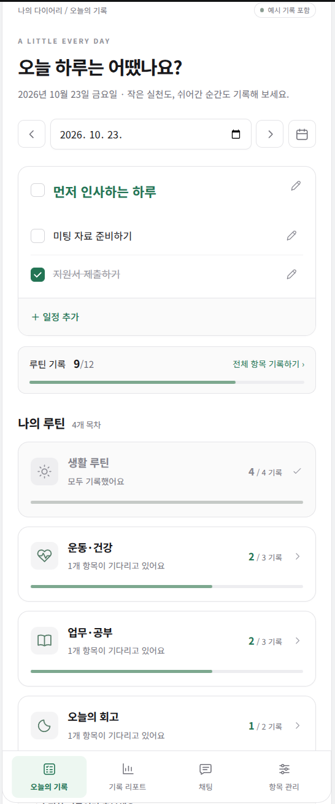
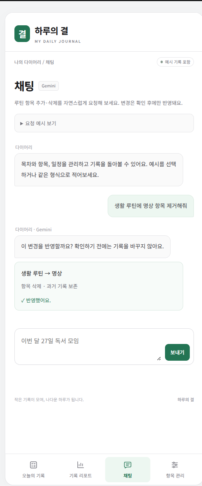
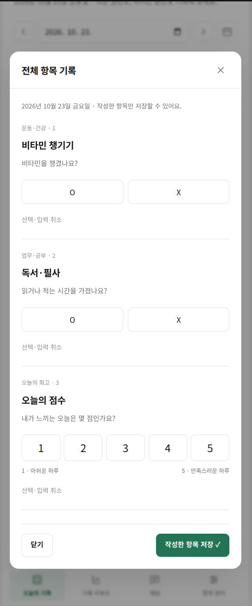
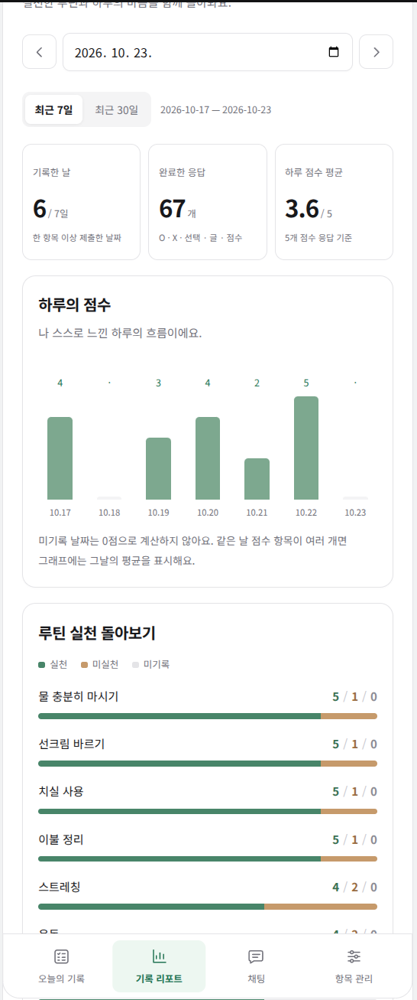
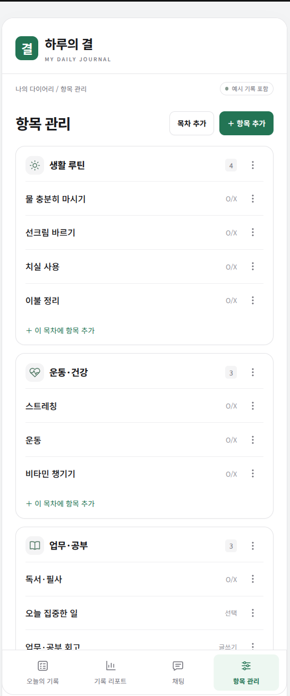

# AI를 활용한 하루 루틴 관리 서비스

AI 서비스 엔지니어링 과정에서 [가계부 account-book](https://github.com/2026-ai-service-engineering-a/account-book)의 실제 처리 흐름과 개발 규칙을 참고해 만든 개인용 습관 다이어리입니다. 기존에 만든 다이어리 화면과 기록 규칙에 Node.js 서버, SQLite 저장, Gemini 루틴 관리를 연결했습니다.

루틴 추가·삭제를 자연어로 요청하고 변경 내용을 확인한 뒤 저장할 수 있습니다. 처음 실행하면 최근 2주 가상 기록이 생성되며, 실제 API 키와 개인 DB는 저장소에 포함하지 않습니다.

| 오늘의 기록 | Gemini 채팅 |
| :---: | :---: |
|  |  |

<details>
<summary>화면 더 보기 — 기록 입력 · 리포트 · 항목 관리</summary>

| 기록 입력 | 리포트 | 항목 관리 |
| :---: | :---: | :---: |
|  |  |  |

</details>

## 실행하기

Node.js **24.18.1 이상 24 계열**이 필요합니다. 실행에는 패키지 설치나 빌드가 필요 없습니다.

```bash
git clone https://github.com/201ssc/ax-track-a-2026.git
cd ax-track-a-2026
npm --prefix sample2 start
```

브라우저에서 **http://localhost:8787/sample2/** 를 엽니다. 종료는 실행한 터미널에서 Ctrl+C입니다. 환경 설정 없이 실행하면 저장·기록·관리와 각본 채팅을 체험할 수 있습니다. Gemini는 아래 설정 후 활성화됩니다. 이 앱은 Node 서버가 필요하므로 GitHub Pages나 HTML 파일 직접 열기로 실행할 수 없습니다.

## Gemini 연결하기

최초 한 번 예시 파일을 복사하고, 실제 값은 `sample2/.env`에서 입력합니다. 기존 `.env`가 있으면 덮어쓰지 않습니다.

```bash
cp -n sample2/.env.example sample2/.env
```

```dotenv
GEMINI_API_KEY=발급받은_키
AGENT_MODEL=gemini/gemini-3.5-flash-lite
AGENT_TIMEOUT_SECONDS=10
```

키를 넣은 뒤 서버를 재시작합니다. 채팅 상단에 Gemini가 표시되면 다음을 한 가지씩 요청해 보세요.

- `생활 루틴에 테스트 명상 항목 추가해줘` → 이름·목차 확인 → 확인하고 반영
- `생활 루틴에 테스트 명상 항목 제거해줘` → 삭제 미리보기 → 취소 또는 확인

**확인 전에는 다이어리가 바뀌지 않습니다.** 삭제 후에도 과거 문항·답변·리포트는 남습니다. Gemini에는 이번 요청과 현재 목차·항목 이름만 보내며, 회고·답변·점수·대화 이력은 보내지 않습니다. 실제 호출은 각자의 키와 API 사용 한도를 사용합니다.

키와 모델을 모두 비우면 각본 모드입니다. 한쪽만 설정하면 시작 오류로 안내합니다. 실제 키는 `.env`에만 넣고 `.env.example`에는 넣지 않습니다.

## 구현한 범위

| 구분 | 현재 동작 |
| --- | --- |
| 기록·관리 | O/X·선택·글쓰기·점수, 일부 저장, 항목 편집·중지·삭제 |
| 제목·일정·리포트 | 날짜별 제목과 일정, 완료 체크, 최근 7일/30일 집계 |
| 실제 저장 | Node HTTP API + SQLite. 서버 재시작 후 유지, 중복 요청 방지·수정 충돌 처리 |
| 실제 AI | Gemini가 루틴 항목 자체의 추가·삭제 의도와 이름을 해석 |
| 각본 기능 | 목차·일정 변경, 정해진 표현의 점수·루틴·일정 조회 |
| 예시 자료 | 최초 DB 생성 시 최근 2주 가상 기록. 이후 입력은 유지 |
| 후속 범위 | 대화 기억, 자유 상담, 추가 AI 도구, 로그인·여러 사용자, 외부 배포 |

기본 DB는 저장소 밖 `~/.local/share/iruo-habit-diary/diary.sqlite`에 생성됩니다(Linux 기준). 다른 실행본과 분리하려면 `.env`의 `DIARY_DB_PATH`를 별도 절대 경로로 지정합니다. 현재 서버는 본인 PC의 로컬 접속용입니다.

## 가계부에서 참고한 부분

가계부의 요청 처리 흐름과 개발 규칙을 다이어리에 적용했습니다.

| 참고한 원칙 | 다이어리에서 적용한 부분 |
| --- | --- |
| 요청 해석과 저장 분리 | Gemini는 의도·이름을 반환하고 서버가 대상을 검증해 명령 생성 |
| 변경 제안 → 사용자 확인 → 저장 | 서버에 제안을 보관하고 확인/취소·만료·중복 확인 처리 |
| 화면과 채팅의 공통 저장 | 같은 명령과 SQLite 트랜잭션을 사용 |
| 계산과 기록 규칙은 코드가 담당 | 기록 기준 집계, 미기록 구분, 삭제 후 과거 기록 보존 |
| 설정·비밀키 분리 | `.env.example`만 공유, 실제 키는 서버에서만 사용 |
| 규칙·계약·검증 문서화 | 인덱스에서 담당 규칙·관련 코드·완료 검사 연결 |

자세한 내용은 [가계부 참고 분석](sample2/docs/reference-account-book.md)에 정리했습니다.

## 문서와 검사

- [상세 사용법](sample2/README.md), [문서 인덱스](sample2/INDEX.md), [현재 상태](sample2/HANDOFF.md)
- [제품 규칙](sample2/docs/product-rules.md), [루틴 도구 계약](sample2/docs/routine-tools.md), [Gemini 계약](sample2/docs/gemini-contract.md)
- [직접 테스트](sample2/docs/manual-check.md), [자동 검사 기준](sample2/docs/verification.md)

```bash
npm --prefix sample2 test
```

일반 검사는 키 없이 실행하며 실제 모델을 호출하지 않습니다. 공유본에서 자동 검사 62개와 브라우저 검사 9종이 통과했습니다. 실제 Gemini 호출·직접 사용자 확인 결과와 자동 대역 검사는 [현재 상태](sample2/HANDOFF.md)에 구분해 기록합니다. 브라우저 검사 설치·실행법은 [상세 사용법](sample2/README.md#검증)에 있습니다.
